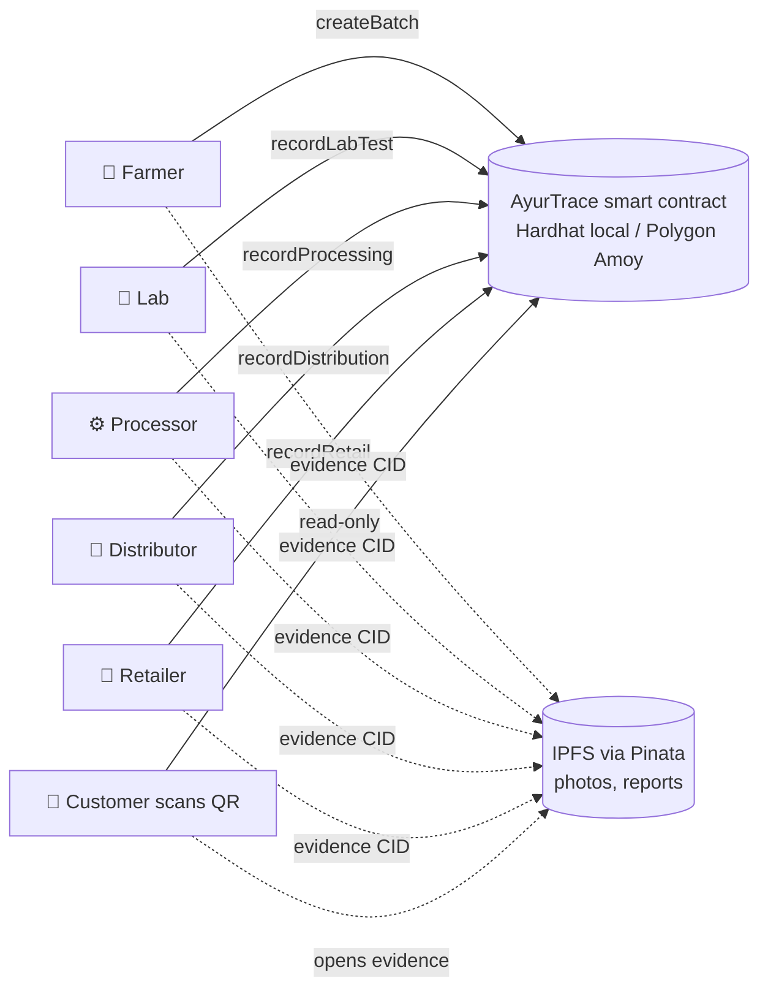

# 🌿 AyurTrace — Farm-to-Customer Traceability for Ayurvedic Herbs

A blockchain-based supply-chain tracker that records every step of an Ayurvedic raw material's journey — **farm → lab → processor → distributor → retailer → customer** — so anyone can verify a product's origin, purity test and handling by scanning a QR code.

> **Why?** Adulteration, fake "organic" labels and unknown sourcing damage trust in Ayurveda. A tamper-evident, publicly readable history helps rebuild that credibility.

## Features

- **Role-based participants** — an admin registers verified farmers, labs, processors, distributors and retailers.
- **Enforced workflow** — stages must happen in order; a batch **cannot be processed unless the lab test passed**.
- **Evidence on IPFS** — photos, certificates and lab reports are stored on IPFS; only the hash goes on-chain.
- **Customer verification page** — no wallet needed; shows timeline, "Lab verified" / "Organic" badges and recall warnings.
- **QR code per batch** — printed on the pack, links straight to the verification page.
- **Recall support** — admin can freeze a contaminated batch.
- **Tests + CI** — Hardhat test suite and GitHub Actions workflow.

## Architecture



Batch lifecycle: `Harvested → LabTested → Processed → Distributed → Retail`

| Layer | Tech |
|---|---|
| Smart contract | Solidity 0.8.20 |
| Dev / test | Hardhat, ethers v6, Chai |
| Network | Hardhat local node → Polygon Amoy testnet |
| File storage | IPFS (Pinata) |
| Frontend | Plain HTML/JS (no build step), ethers v6, qrcodejs |

## Project structure

```
contracts/AyurTrace.sol     smart contract
test/AyurTrace.test.js      Hardhat tests
scripts/deploy.js           deploys + writes frontend/config.js
scripts/seed.js             demo roles + one full batch (local)
frontend/                   index, verify (customer), dashboard (partners)
docs/architecture.md        design notes, threat model
.github/workflows/ci.yml    CI: compile + test
```

## Quick start (local demo)

Requirements: Node.js 18+ and the MetaMask browser extension.

```bash
npm install
npx hardhat test                 # run the test suite

# terminal 1
npx hardhat node                 # local chain with 20 funded accounts

# terminal 2
npm run deploy:local             # deploys and writes frontend/config.js
npm run seed:local               # registers demo roles + creates batch #1
npm run frontend                 # serves http://localhost:3000
```

Then open **http://localhost:3000/verify.html?id=1** to see the customer view of the seeded batch.

### Use the partner dashboard with MetaMask

1. In MetaMask add a network: RPC `http://127.0.0.1:8545`, chain ID `31337`.
2. Import the Hardhat test accounts using the private keys printed by `npx hardhat node`
   (account 0 = admin, 1 = farmer, 2 = lab, 3 = processor, 4 = distributor, 5 = retailer).
   **These keys are public — never use them on a real network.**
3. Open `http://localhost:3000/dashboard.html`, connect, and the page shows the forms for that wallet's role.

## Deploy to Polygon Amoy testnet

```bash
cp .env.example .env     # add AMOY_RPC_URL and a TEST wallet PRIVATE_KEY (never a real one)
npm run deploy:amoy      # needs test MATIC from a faucet
```

`deploy.js` rewrites `frontend/config.js` with the new address. Host the `frontend/` folder on GitHub Pages / Netlify / Vercel so customers can open the QR links.

## Smart contract API

| Function | Who | Purpose |
|---|---|---|
| `grantRole(user, role)` | admin | register / revoke a partner |
| `createBatch(...)` | farmer | start a batch at harvest |
| `recordLabTest(id, passed, ...)` | lab | purity / adulteration result |
| `recordProcessing(id, ...)` | processor | requires lab pass |
| `recordDistribution(id, ...)` | distributor | transport & storage |
| `recordRetail(id, ...)` | retailer | final sale point |
| `recallBatch(id, reason)` | admin | freeze a batch |
| `getBatch(id)` / `getHistory(id)` | anyone | public verification |

## Limitations (read before claiming too much)

- **The chain proves *who* recorded *what* and *when* — not that it is true.** Trust depends on who the admin registers and on accredited labs. Stronger designs add GPS-tagged photos, IoT sensors, and lab-signed reports.
- **Single admin** is a centralisation point; a real deployment would use a multisig or an industry consortium.
- **Privacy:** everything on a public chain is public. Don't store personal farmer data on-chain.
- Prototype for learning/demo — **not audited**; don't use it with real funds.

## Roadmap

- [ ] Multisig / DAO-style admin
- [ ] Farmer payments released on lab approval
- [ ] IoT temperature/humidity logging
- [ ] Batch splitting (one harvest → many retail packs)
- [ ] Mobile QR scanner app
- [ ] Hindi / Bengali UI

## License

MIT
